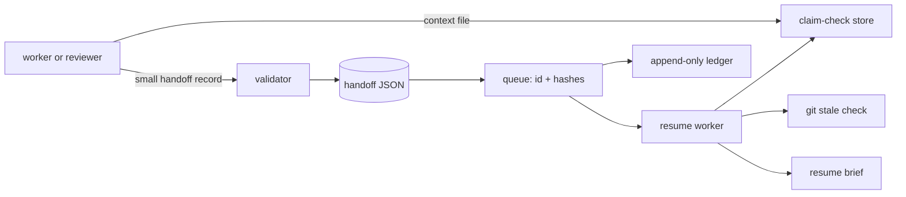
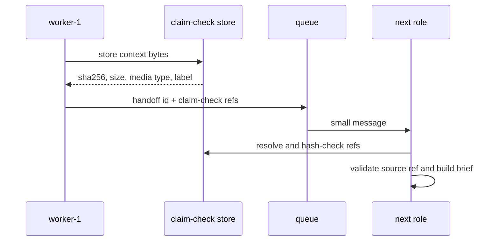
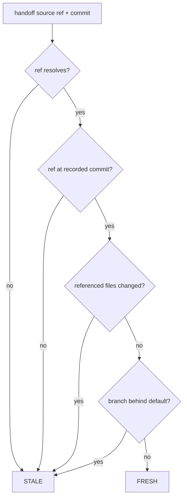

# claim-check-handoff-ledger

Long-running work loses context when a person or agent resumes in a new session. Pasting every note, file, and intermediate result into each message is expensive, difficult to audit, and stale as soon as the source changes.

This repository is a small, runnable demonstration of the Claim Check enterprise integration pattern for a toy todo app. A handoff record keeps the decision-shaped metadata. Larger context files live in a content-addressed claim-check store. A queue message carries only the handoff id and hashes. The receiver verifies the schema, verifies every hash, and checks whether the recorded source ref still points at the recorded commit.

## What is here

- A draft 2020-12 JSON Schema and strict TypeScript validator.
- A filesystem claim-check store with SHA-256 deduplication and tamper detection.
- An optional Azure Blob claim-check store using managed identity.
- An in-memory queue and an optional Azure Storage Queue adapter; messages are kept under 4 KB.
- Git-based stale-reference detection, including changed referenced files and branches behind `main`.
- A concise Markdown resume brief.
- A local CLI and Azure Functions v4 HTTP/queue handlers.
- Bicep for storage, Functions, identity, RBAC, observability, and GitHub OIDC.

## Architecture



## Handoff and resume sequence



## Stale detection flow



## Run locally

With Node 20 installed, one command installs dependencies, typechecks, and runs the fast test suite:

```sh
npm install && npm run lint && npm test
```

The CLI is available as:

```sh
npm run handoff -- list
```

Create a handoff from flags (run inside a git repository with a `main` ref):

```sh
npm run handoff -- new --author-role worker-1 --task "Review the todo list" --next-step "Run tests" --context todos.txt
```

Use `--json path/to/handoff.json` to validate and store a complete record instead. `HANDOFF_DATA_DIR` selects the local data directory; it defaults to `.handoff-ledger/`.

## Todo-app walkthrough

The complete flow is in [examples/WALKTHROUGH.md](examples/WALKTHROUGH.md). In short, `npm run sample` creates a temporary todo repository with multiple commits. `new` stores `todos.txt` as a claim check. After another commit, `verify` exits nonzero and reports `STALE`; `resume` prints the brief with that warning.

## Tradeoffs

- Blob lifecycle and retention need explicit policy. Content-addressed blobs are easy to reuse, but orphan cleanup, legal retention, and versioning need a separate job.
- A hash is a content identity, not a mutable version identity. It detects corruption and deduplicates bytes, but a new hash is required for every edit.
- Git staleness is intentionally conservative. A changed file can be harmless, while an unchanged file can still be semantically outdated.
- The queue message limit keeps transport reliable, but it means the durable store must be reachable before resume.
- Local filesystem mode is simple and cheap. Azure adds availability, identity, and operational cost.

## What I would do in production

I would add authenticated handoff submission, tenant and role authorization, encryption and key rotation, claim-check retention and garbage collection, signed handoff records, a durable handoff index, retry/dead-letter policy, structured audit events, metrics for stale resumes, and an explicit source adapter for non-Git work. I would also make the default branch configurable per repository and require a human decision when a stale handoff is resumed.

## Verification

```sh
npm run lint
npm test
npm run build
```

No commit or push is performed by this project setup.
